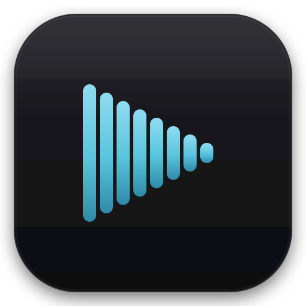
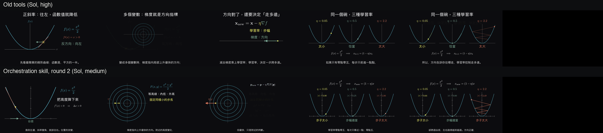
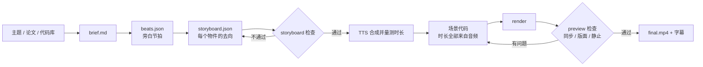

 <div align="center">

> [English](./README_en.md) | **简体中文**



# AnyToManim

**让编码 Agent 做出有连续性的讲解动画：一套 Skill、一组确定性工具，和一个能证明它们是否有用的评测。**


</div>

---

## 这个项目在回答什么问题

现在的模型已经能直接写 Manim、配旁白、自己检查成品。所以真正的问题不是「能不能生成动画」，而是：

> **在模型已经很强的情况下，一个 Skill 还能增加什么？怎么证明？**

AnyToManim 最早也内置了一个 Agent 来驱动生成。后来我们用直接生成做基线，发现差距并不大，于是放弃内置 Agent，改做三件事：

1. **Skill：** 把模型不会自己想到的东西写下来，重点是「编排」，也就是物件如何从一个镜头延续到下一个。
2. **工具：** 把确定性的事交给 CLI：语音合成、测时长、渲染、分镜检查、版面检查、字幕。
3. **评测：** 在隔离环境里对比有无 Skill，让 Skill 在结果里迭代，而不是凭感觉改。

模型负责创作，CLI 负责确定性工作，评测负责说真话。

## 效果

同一模型、同一主题。上排是旧工具，每段换一个标题；下排是编排 Skill，没有常驻标题，主图更大，物件跨段保留。静态截图看不出全部差别，连续性要看影片：12 支对照影片在 [`docs/evals/round2/`](docs/evals/round2/)，克隆后用浏览器打开 `index.html` 即可。



三个主题（梯度下降、傅立叶级数、哈希表）的量测：

| 指标 | 旧工具<br>Sol 高强度 | Skill 第一版<br>Sol 高强度 | Skill 第二版<br>Sol 中强度 |
|---|---:|---:|---:|
| 清空画面（次/分钟） | 2.3–6.4 | **0** | 分镜计划 0，未量测 |
| 物件停留时间 | 6.4–7.4 秒 | **8.5–10.5 秒** | 未量测 |
| 静止画面占比 | 9–17% | 35–50% | **19–33%** |
| 镜头移动 | 0 | 0 | **1–3 个节拍** |
| 常驻标题 | 1/3 支 | 3/3 支 | **0/3 支** |

**这些数字该怎么读：** 每格只有一支影片，第二版还换了思考强度，所以这是诊断，不是结论。第一版让连续性变好，却让画面变静、变空；第二版修的正是这两点。这个来回才是评测的价值。

## 工作方式



设计上有两个判断：

- **音频先行。** 先合成旁白并量出真实秒数，动画时长都从音频派生，同步是构造出来的，不是事后对齐的。
- **先定去向，再写代码。** 写场景前先写 `storyboard.json`，规定每个物件这一拍是保留、变形还是退场。退场要写理由。

## Skill 里有什么

| 内容 | 位置 | 作用 |
|---|---|---|
| 编排原则 | [`ORCHESTRATION.md`](src/anytomanim/guides/ORCHESTRATION.md) | 退场前先问：它能不能变成下一个东西？ |
| 分镜规范 | [`STORYBOARD.md`](src/anytomanim/guides/STORYBOARD.md) | 把连续性变成可检查的计划 |
| 场景规范 | [`SCENE_GUIDE.md`](src/anytomanim/guides/SCENE_GUIDE.md) | 节奏、填满画面、镜头、可读性 |
| 文案规范 | [`SCRIPT.md`](src/anytomanim/guides/SCRIPT.md) | 让每句话接住上一句 |
| 14 个范例 | [`recipes/`](src/anytomanim/guides/recipes/README.md) | 每个范例演示一种编排，可直接渲染 |

## 评测怎么做

### 对照组必须干净

`anytomanim bench` 让模型在有无工具链的条件下完成同一题，产物落在同一结构里，方便比较。

- 两组都用干净的 `HOME` 和 `CODEX_HOME`，不加载个人配置、技能和记忆。
- 对照组在中性路径运行，提示词不出现项目名称和路径，所用 Python 里没有本项目。
- macOS Seatbelt 在系统层禁止读取项目，而不是靠提示词要求。跑完再扫描日志，记录越界和联网指令。

隔离要能被验证：我们让模型主动尝试读取项目，确认读取失败，也确认它看不到技能列表和全局指示。

### 三层评审，各管各的

| 层 | 工具 | 擅长 | 看不到 |
|---|---|---|---|
| 量测 | `eval`、`preview`、`storyboard` | 清场、静止、版面、同步，稳定可重复 | 内容好不好 |
| AI 评审 | `judge`（成对盲评） | 准确性、可读性、画面完成度 | 旁白，也不直接评连续性 |
| 人 | `blind` 或对照页 | 看得懂吗、顺不顺 | 样本小，可能有偏见 |

三层可以互相矛盾，这正是我们想要的。第一版 Skill 在 AI 评审中输给旧工具（9 次评分 2 比 7），量测和人工观看却都说连续性更好。我们没有选一个来相信，而是逐条查证：AI 指出的残影是真的，它没评到的连续性也是真的。

### 这份评测不能证明什么

- 每个主题只有一支影片，差异可能来自随机波动。
- 人工判断来自作者一人，看片时知道版本，不是盲评。
- 评测主要在 Codex 的模型上进行，语音用本机 TTS，所以没有评估声音。
- 「画面要满」是我们的审美选择，不是从数据得出的结论。

## 快速开始

```bash
git clone https://github.com/RayMorTwinkle/AnyToManim.git
cd AnyToManim
pip install -e .
anytomanim doctor          # 检查 ffmpeg、LaTeX 等依赖
```

也可以直接交给 Agent：

```text
安装 AnyToManim，运行 anytomanim doctor 并补齐依赖。
再用 anytomanim export-guides ./guides 导出规范，
按 guides/WORKFLOW.md 做一支讲解影片，主题是：<你的主题>
```

不需要 API Key 也能试：设置 `ANYTOMANIM_TTS=draft`，就会使用本机语音。正式旁白使用 MiMo-TTS，把 `MIMO_API_KEY` 写进 `.env`。

## 命令

| 命令 | 用途 |
|---|---|
| `doctor` | 检查环境 |
| `export-guides` | 导出 Skill 规范和范例 |
| `tts` / `measure` | 合成旁白、量测时长 |
| `storyboard` | 检查分镜连续性 |
| `render` / `preview` | 渲染，并输出逐拍总览、同步与版面警告 |
| `assemble` / `subtitles` / `bgm` | 拼接、字幕、配乐 |
| `eval` | 对任意 MP4 做诊断，不给总分 |
| `judge` / `blind` | AI 成对评审、生成人工盲评素材 |
| `bench` / `bench-report` | 跑评测矩阵并汇总 |

## 已知问题

- 长条形主体（比如数组）仍然容易留下大片空白，哈希表那支影片就是例子。
- `preview` 的「主体过小」警告会误报并排的小图，只能当提示。
- 分镜检查只检查计划，不检查影片是否照做。
- 隔离依赖 macOS 的 `sandbox-exec`，其他系统上 `bench` 会拒绝运行。

## 致谢与许可

代码以 [MIT](LICENSE) 授权。

动画技法受 [3Blue1Brown](https://www.3blue1brown.com/) 启发，本项目与 3Blue1Brown 没有任何关联，不包含其视频、字幕或声音，代码为独立实现。渲染基于 [Manim Community](https://www.manim.community/)。

本项目由 RayMor 主导，开发过程使用 Claude Code 和 Codex 协作完成。
