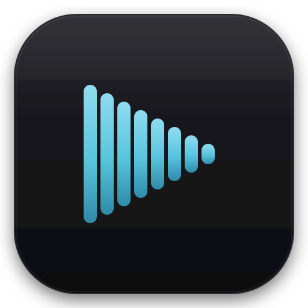
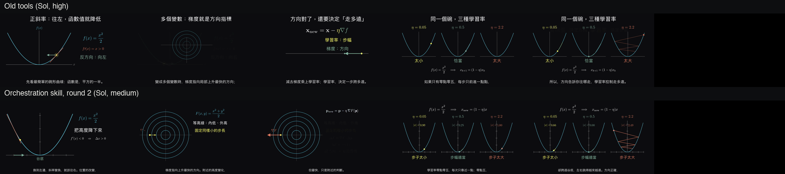
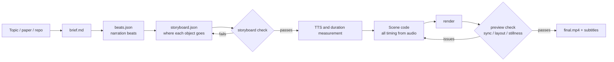

<div align="center">

> **English** | [简体中文](./README.md)



# AnyToManim

**Helping coding agents make explainer animations with real continuity: a skill, a set of deterministic tools, and an evaluation that shows whether they help.**


</div>

---

## The question

Current models can already write Manim, add narration and check their own output. So the real question is no longer whether an agent can generate an animation. It is this:

> **When the model is already strong, what can a skill still add, and how do you prove it?**

AnyToManim began with a built-in agent driving generation, like most projects in this space. When we benchmarked it against direct generation, the gap was small. So we dropped the built-in agent and focused on three things:

1. **Skill:** write down what models do not work out alone, above all *orchestration*: how objects carry from one shot to the next.
2. **Tools:** give deterministic work to a CLI: speech synthesis, duration measurement, rendering, storyboard and layout checks, subtitles.
3. **Evaluation:** compare with and without the skill in an isolated environment, and let the results drive the next change.

The model creates, the CLI handles what must be exact, and the evaluation keeps everyone honest.

## Results

Same model, same topic. The top row is the old toolchain, which changes heading per section. The bottom row uses the orchestration skill, with no fixed title, a larger main picture and objects that persist across sections. Stills cannot show everything: continuity needs video. The 12 comparison videos are in [`docs/evals/round2/`](docs/evals/round2/); clone the repo and open `index.html` in a browser.



Measurements across three topics (gradient descent, Fourier series, hash tables):

| Metric | Old tools<br>Sol, high effort | Skill v1<br>Sol, high effort | Skill v2<br>Sol, medium effort |
|---|---:|---:|---:|
| Full clears per minute | 2.3–6.4 | **0** | 0 planned, not measured |
| Object lifetime | 6.4–7.4 s | **8.5–10.5 s** | not measured |
| Still-frame share | 9–17% | 35–50% | **19–33%** |
| Camera moves | 0 | 0 | **1–3 beats** |
| Fixed title | 1 of 3 | 3 of 3 | **0 of 3** |

**How to read this:** each cell is one video, and v2 also changed reasoning effort, so these are diagnostics, not conclusions. v1 improved continuity but left frames more static and emptier. v2 targeted exactly those two problems. That back-and-forth is what the evaluation is for.

## How it works



Two design decisions matter most:

- **Audio first.** Narration is synthesized and measured before any animation is timed, so sync comes from construction rather than later alignment.
- **Decide where objects go before writing code.** `storyboard.json` says whether each object stays, transforms or leaves on each beat. Leaving needs a reason.

## What is in the skill

| Content | Location | Purpose |
|---|---|---|
| Orchestration principles | [`ORCHESTRATION.md`](src/anytomanim/guides/ORCHESTRATION.md) | Before something leaves, ask whether it can become the next thing |
| Storyboard spec | [`STORYBOARD.md`](src/anytomanim/guides/STORYBOARD.md) | Turns continuity into a checkable plan |
| Scene spec | [`SCENE_GUIDE.md`](src/anytomanim/guides/SCENE_GUIDE.md) | Pacing, frame use, camera, legibility |
| Script spec | [`SCRIPT.md`](src/anytomanim/guides/SCRIPT.md) | Makes each sentence pick up the last one |
| 14 recipes | [`recipes/`](src/anytomanim/guides/recipes/README.md) | One runnable example per orchestration pattern |

## How the evaluation works

### The baseline has to be clean

`anytomanim bench` gives a model the same task with and without the toolchain, in a matching output layout.

- Both arms run with a clean `HOME` and `CODEX_HOME`, without personal config, skills or memories.
- The baseline runs from a neutral path. Its prompt never names the project, and its Python does not contain it.
- macOS Seatbelt blocks reads of the project at system level, rather than relying on a prompt. Logs are then scanned for out-of-bounds paths and network commands.

Isolation has to be testable. We asked a model to try to read the project, confirmed the reads failed, and confirmed it saw no skill list or global instructions.

### Three layers of review

| Layer | Tool | Good at | Cannot see |
|---|---|---|---|
| Measurement | `eval`, `preview`, `storyboard` | Clears, stillness, layout, sync; stable and repeatable | Whether the content is good |
| AI judge | `judge` (blind, pairwise) | Accuracy, legibility, visual finish | Narration; does not directly score continuity |
| Human | `blind` or a comparison page | Is it clear, does it flow | Small samples, possible bias |

These layers can disagree, and that is the point. Skill v1 lost to the old tools with the AI judge (2 to 7 across 9 ratings), while measurements and human viewing both found better continuity. We did not pick a side. We checked each claim: the leftover labels the judge flagged were real, and the continuity it did not score was real too.

### What this evaluation does not prove

- Each topic has one video, so differences may be random variation.
- Human judgment came from one person, the author, who knew which version was which. It was not blind.
- Runs mainly used Codex models and a local voice, so narration audio was not evaluated.
- "Fill the frame" is our aesthetic choice, not a finding from the data.

## Quick start

```bash
git clone https://github.com/RayMorTwinkle/AnyToManim.git
cd AnyToManim
pip install -e .
anytomanim doctor          # checks ffmpeg, LaTeX and other dependencies
```

Or hand it to your agent:

```text
Install AnyToManim, run anytomanim doctor and fix what it reports.
Export the specs with anytomanim export-guides ./guides,
then follow guides/WORKFLOW.md to make an explainer video about: <your topic>
```

You can try it without an API key: `ANYTOMANIM_TTS=draft` uses a local voice. For final narration, put `MIMO_API_KEY` in `.env` to use MiMo-TTS.

## Commands

| Command | Purpose |
|---|---|
| `doctor` | Check the environment |
| `export-guides` | Export the skill specs and recipes |
| `tts` / `measure` | Synthesize narration, measure duration |
| `storyboard` | Check storyboard continuity |
| `render` / `preview` | Render, then produce a per-beat sheet with sync and layout warnings |
| `assemble` / `subtitles` / `bgm` | Concatenate, subtitle, add music |
| `eval` | Diagnostics for any MP4, with no overall score |
| `judge` / `blind` | AI pairwise judging, human blind-review material |
| `bench` / `bench-report` | Run and summarize the benchmark matrix |

## Known issues

- Long, thin subjects such as arrays can still leave large empty areas, as the hash table video shows.
- The `preview` small-content warning can misfire on side-by-side panels, so treat it as a prompt.
- The storyboard check verifies the plan, not whether the video followed it.
- Isolation relies on macOS `sandbox-exec`; `bench` refuses to run elsewhere.

## Credits and license

Code is under the [MIT](LICENSE) license.

The animation techniques are inspired by [3Blue1Brown](https://www.3blue1brown.com/). This project is not affiliated with 3Blue1Brown. It contains none of their videos, captions or voice, and the code is an independent implementation. Rendering uses [Manim Community](https://www.manim.community/).

Led by RayMor, built in collaboration with Claude Code and Codex.
